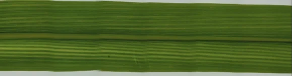
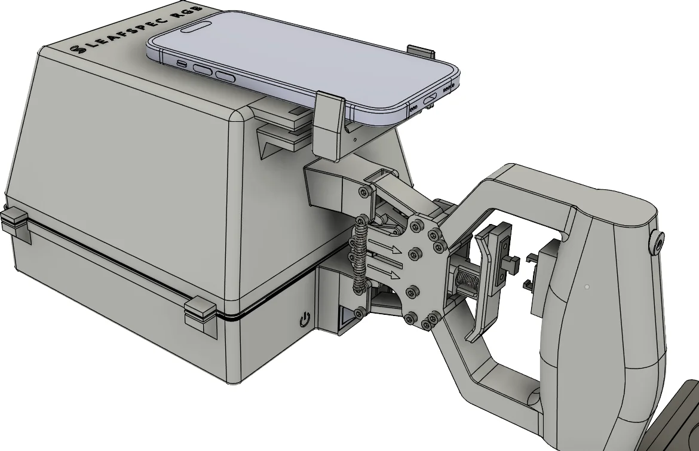

M.S. student in Agricultural & Biological Engineering at Purdue (May 2027), building hardware for plant sensing and imaging.

---

## Projects

<table>
  <tr>
    <td width="38%" valign="top">
      
    </td>
    <td valign="top">
      <h3><a href="https://github.com/CharlesWang435/LeafDocV2">LeafDoc</a></h3>
      A $50 smartphone leaf-imaging light box deployed in a Purdue–DARPA study (<b>6,500+ captures</b>). The Android app (Kotlin, CameraX + Camera2) does manual-camera backlit capture with GPS and trial metadata, stitches frames into a full-leaf panorama, and uses an LLM to output a 0–100 plant-health score with disease classification.
        
      
       
      <b>Repo:</b> <a href="https://github.com/CharlesWang435/LeafDocV2">CharlesWang435/LeafDocV2</a> · <a href="https://github.com/CharlesWang435/LeafDocV2/tree/main/hardware">hardware/</a>
    </td>
  </tr>
  <tr>
    <td width="38%" valign="top">
      
    </td>
    <td valign="top">
      <h3><a href="https://github.com/CharlesWang435/LeafDocV2/tree/main/hardware">LeafStudio lightbox</a> (new, Nov 2026)</h3>
      The next-generation LeafDoc enclosure: a light-tight box with a diffused 15 × 15 cm LED window, a spring-loaded clamp handle and a push-push latch, so any phone gets identical distance, angle and lighting on every shot. Fusion CAD, print-ready STLs and build notes are open in the repo.
        
      <b>Repo:</b> <a href="https://github.com/CharlesWang435/LeafDocV2/tree/main/hardware">LeafDocV2/hardware</a>
    </td>
  </tr>
</table>

### Leaf Cross-Section Microscope Imager (M.S. thesis)
Portable 100× corn-leaf imager with a tunable liquid lens. A Raspberry Pi 5 drives a linear stage and a servo-focused objective, autofocuses each segment with a Brenner-gradient metric, and captures 2840 × 2840 TIFFs, all from a browser UI. Capture time cut from 15 min to **under 3 min**. Code is private while the thesis is in progress.

### Also
- **FluoroScan**: sub-$2,000 chlorophyll fluorescence imager (vs $20,000+ commercial units).
- **LeafSpec-Multi**: portable multispectral tower; 400+ field scans for a co-authored peer-reviewed study.

## Skills
- **Software:** Python, OpenCV, Android (Kotlin, CameraX), LLM integration
- **Hardware:** Raspberry Pi, microcontrollers, MOSFET LED drivers, motor control
- **Design & imaging:** SolidWorks, Fusion, 3D printing, multispectral imaging, microscopy
