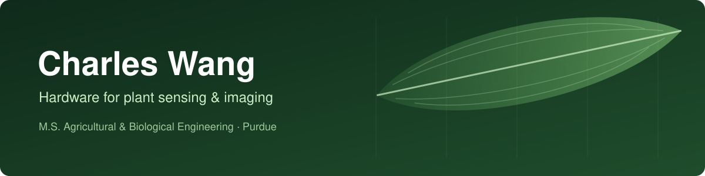
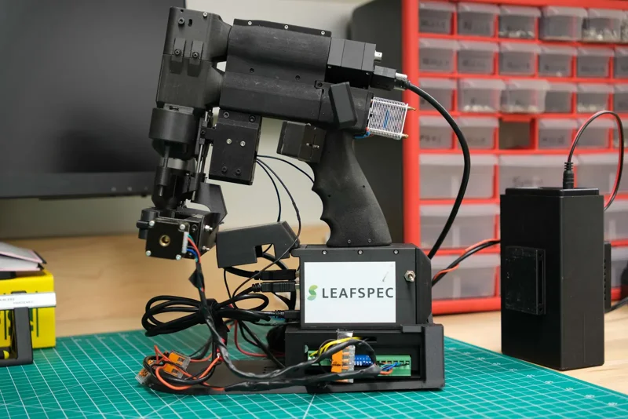
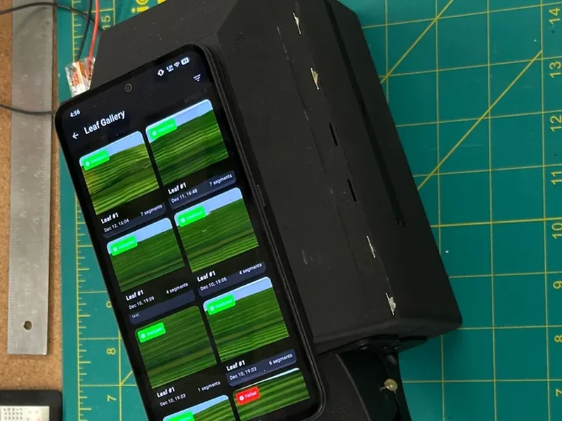
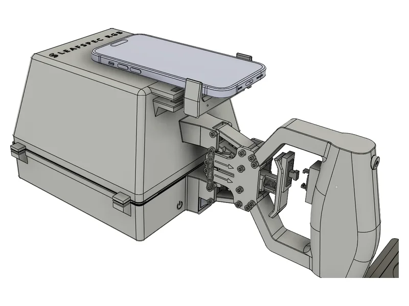
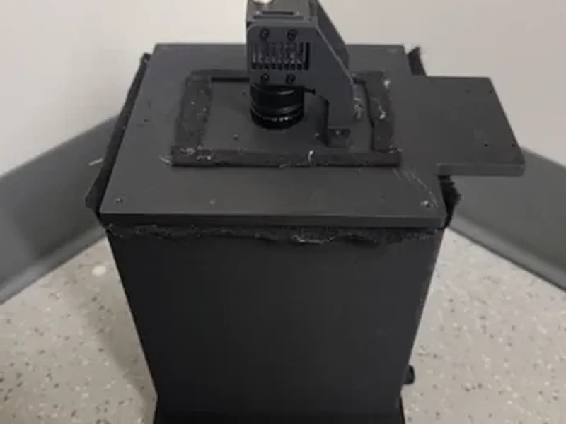
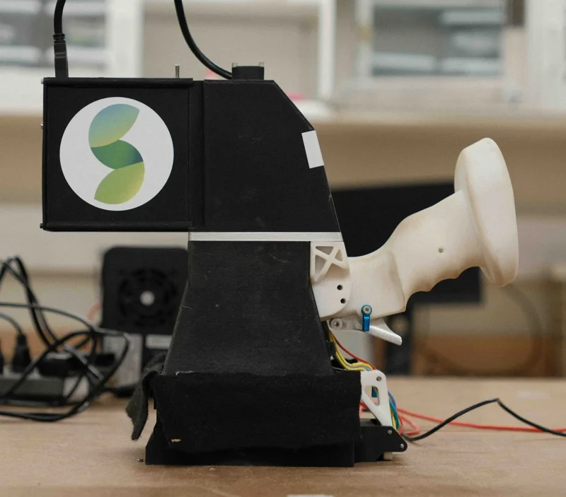

**Hardware engineer building handheld imaging instruments, from the CAD and electronics down to the software that runs them.**

Four leaf-imaging devices built so far. Looking for a role in hardware engineering or R&D.

---

## Projects

<table>
  <tr>
    <td width="38%" valign="top">
      
    </td>
    <td valign="top">
      <h3><a href="https://github.com/CharlesWang435/LeafSpec-Cross-Sectional-Imager">Leaf Cross-Section Microscope Imager</a> (M.S. project, in progress)</h3>
      A modular attachment for the LeafSpec confocal microscope that images a full corn-leaf cross section at 100×. A 3D-printed clamp on a motorized rail steps the cut leaf under the objective; a Raspberry Pi 5 web console gives live preview, motor control and autofocus. Prototype 2 swaps the mechanical focus for an <b>electrically tunable liquid lens</b> and a weight-balanced rack-and-pinion stage.
        
      <b>Stack:</b> optics, liquid lens, motor control, Raspberry Pi, Flask, SolidWorks
       
      <b>Repo:</b> <a href="https://github.com/CharlesWang435/LeafSpec-Cross-Sectional-Imager">CharlesWang435/LeafSpec-Cross-Sectional-Imager</a> (build log and photos) · <a href="https://charleswang435.github.io/#microscope">portfolio</a>
    </td>
  </tr>
  <tr>
    <td width="38%" valign="top">
      
    </td>
    <td valign="top">
      <h3><a href="https://github.com/CharlesWang435/LeafDoc">LeafDoc</a></h3>
      A $50 smartphone lightbox, through seven printed enclosure revisions, that blocks ambient light and holds the leaf flat for repeatable backlit images. Used in a Purdue–DARPA study (<b>6,500+ captures</b>). The companion Android app (Kotlin, CameraX + Camera2) gives manual camera control, GPS and trial metadata, frame stitching, and LLM-based plant-health scoring.
        
      
       
      <b>Stack:</b> SolidWorks, 3D printing, Kotlin, CameraX, image stitching
       
      <b>Repo:</b> <a href="https://github.com/CharlesWang435/LeafDoc">CharlesWang435/LeafDoc</a>
    </td>
  </tr>
  <tr>
    <td width="38%" valign="top">
      
    </td>
    <td valign="top">
      <h3><a href="https://github.com/CharlesWang435/LeafDoc#next-the-leafstudio-lightbox">LeafStudio lightbox</a> (Proto 1, in build)</h3>
      The next-generation LeafDoc enclosure (formerly LeafSpec RGB): a light-tight box with a diffused 15 × 15 cm LED window, a spring-loaded clamp handle and a push-push latch, so any phone gets identical distance, angle and lighting on every shot. Designed in Fusion and 3D-printed.
        
      <b>Repo:</b> <a href="https://github.com/CharlesWang435/LeafDoc#next-the-leafstudio-lightbox">CharlesWang435/LeafDoc</a>
    </td>
  </tr>
  <tr>
    <td width="38%" valign="top">
      
    </td>
    <td valign="top">
      <h3><a href="https://charleswang435.github.io/#fluoroscan">FluoroScan</a></h3>
      A chlorophyll-fluorescence (Fv/Fm) imager for under $2,000 in parts, against $20,000+ commercial units. Twelve 450 nm LEDs on hand-soldered star boards, a 680/720 nm emission bandpass, and one timed sequence that fires the saturating pulse and trips the shutter together. Prototype, not yet validated against a commercial fluorometer.
        
      <b>Stack:</b> Raspberry Pi, LED arrays, optics, SolidWorks
       
      <b>Write-up:</b> <a href="https://charleswang435.github.io/#fluoroscan">portfolio</a>
    </td>
  </tr>
  <tr>
    <td width="38%" valign="top">
      
    </td>
    <td valign="top">
      <h3><a href="https://charleswang435.github.io/#multispectral">LeafSpec-Multi multispectral imager</a></h3>
      Rebuilt an undocumented handheld multispectral imager from its SolidWorks assembly alone: reverse-engineered every subsystem, hand-soldered <b>120+ LEDs</b> across 6 bands with per-band MOSFET drivers, and moved the Pi and 12 V→5 V power into the body (~30% smaller). Images at 0.04 mm/pixel; its data supported a <a href="https://doi.org/10.1016/j.compag.2025.111018">peer-reviewed study</a> I co-authored (90% classification accuracy).
        
      <b>Stack:</b> Raspberry Pi, MOSFET switching, 3D printing, reverse engineering
       
      <b>Write-up:</b> <a href="https://charleswang435.github.io/#multispectral">portfolio</a>
    </td>
  </tr>
</table>

## Experience
- **Hardware Engineer**, LeafSpec LLC · Purdue ABE Plant Sensor Lab (May 2024 – present). Handheld crop-imaging instruments from concept to field deployment; lab imagers in use by partners including Corteva.
- **Summer Research Fellow**, Institute for Digital Forestry, Purdue (May – Jul 2024). LeafSpec-Multi rebuild.
- **Education:** M.S. Agricultural & Biological Engineering, Purdue (expected May 2027) · B.S. Biological Engineering, Purdue (Dec 2025)

## Skills
- **Design & fabrication:** SolidWorks, Fusion, 3D printing (Bambu Lab), enclosure design, optical path layout
- **Electronics:** hand soldering, MOSFET switching, Raspberry Pi, microcontrollers, motor control, LED arrays
- **Software:** Python, C, MATLAB, Kotlin + Android + CameraX, image stitching, web control interfaces
- **Imaging:** multispectral and hyperspectral imaging, chlorophyll fluorescence, microscopy, liquid-lens focusing
